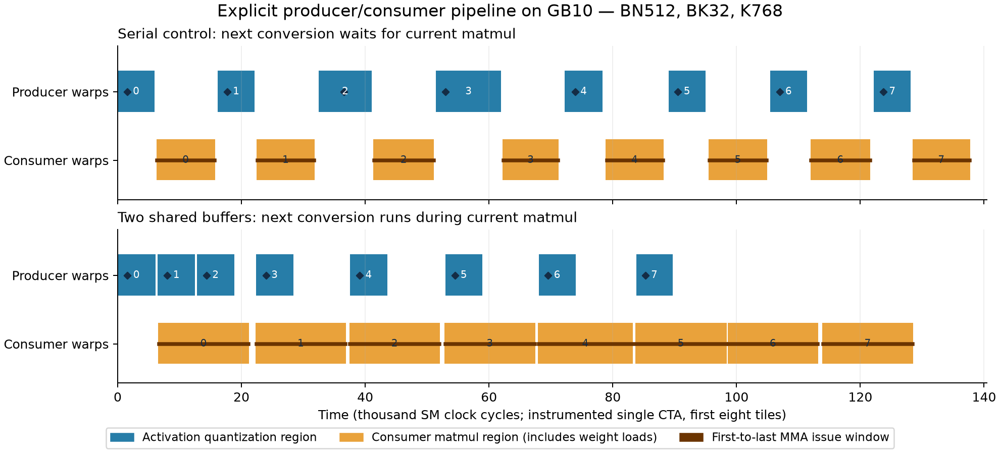

# Explicit producer/consumer MXFP8 pipeline on DGX Spark

This experiment implements separate producer and consumer warps with two shared
activation buffers. It demonstrates concurrent worker roles on GB10 and passes
synchronization, race and memory checks. It does not improve training throughput.
The established separate-packing/native-GEMM path remains substantially faster.

## Kernel and buffer ownership

The selected configuration is BM16/BN512/BK32, four producer warps and four
consumer warps per CTA (configuration 2). Weights are packed once before launch,
including the reconstructed BF16 weight needed for backward. Producers read
original FP32 activations, compute per-32-element scales and E4M3 values, write
the selected shared buffer, and arrive at its ready barrier. Each producer
participates directly in the barrier, releasing its own writes.

Consumers wait for ready, copy their activation fragments and scales to
registers, and arrive at the empty barrier. Each consumer participates, so the
buffer is available for overwrite only after every consumer has finished reading
it. Consumers then load prepacked weight fragments and issue native SM121a
block-scaled MMA from registers. Producers can fill future tiles concurrently.
Each ring slot has a separate ready and empty barrier with alternating phases.
No TMEM, tcgen05, software GEMM emulation, or global spin flags are used.

The serial control uses identical conversion arithmetic, MMA geometry, worker
counts and saved tensors. Its buffer handshake prevents next-tile production
until all consumers finish the current MMA loop. The comparison includes the
synchronization effects of enabling the pipeline, not just an isolated tensor
unit throughput measurement.

Activations still convert once per N output tile: six times for N3072/BN512.
This is not globally once-only activation packing. Weights convert once per call;
no packed weight cache survives an optimizer update. Activation reconstructions
are written once per element by the CTA with N tile index zero.

Native fragment mapping and barrier semantics follow the
[NVIDIA PTX ISA](https://docs.nvidia.com/cuda/parallel-thread-execution/).
The CUDA source uses explicit inline PTX for scaled MMA and hardware barriers.

## Measured concurrency evidence

`trace_producer_consumer.py` records clock64 timestamps inside both worker roles
for one CTA. For every tile it saves producer start/end, consumer start/end,
first/last MMA issue checkpoints, and a checkpoint after the producer's first
quantized row has been stored and its warp synchronized. Thus the evidence goes
beyond source lookahead or the presence of asynchronous-copy instructions.

For the selected K768/BK32 case, all **23 steady tile transitions** have a
future-tile conversion checkpoint inside the current consumer's MMA issue
window. The serial control has **zero**. For K4096/BK32, the counts are **127
versus zero**. All five traced configurations show positive concurrency and no
such checkpoints in their serial controls. Raw per-tile timestamps and matching
pairs are retained in `concurrency-traces.json`.



The plotted numbers identify tiles; diamonds mark conversion checkpoints; dark
consumer segments show first-to-last MMA issue windows. The chart shows the first
eight tiles of the instrumented single-CTA K768 trace on a common cycle scale.

These are instrumented worker execution windows, including role-local loads and
synchronization. They establish concurrent producer/consumer progress and
conversion checkpoints during consumer MMA work. They do not measure a hardware
tensor/scalar simultaneous-active percentage. Instrumentation changes scheduling;
it is disabled in all performance measurements below.

## Uninstrumented production-shape timing

Seed 44; four alternating forward/reverse timing orders, 100 ms warmup and
300 ms measurement per path per order. M8192/N3072/K768, all required weight
packing and saved reconstructed tensors included. Median milliseconds:

| Implementation | ms per first-projection call |
|---|---:|
| Separate native activation/weight packing + native GEMM | **0.633** |
| Config 2: serial producer/consumer control | 3.291 |
| Config 2: double-buffered producer/consumer pipeline | 2.988 |
| Config 9: serial control, BN512/BK64, two producer warps | 4.671 |
| Config 9: overlap, BN512/BK64, two producer warps | 7.614 |

Config 2 takes **9.2% less time** than its serial control (1.10x throughput),
but still takes **4.72x** the native baseline's time. Some configurations regress
when concurrency is enabled. Overlap can introduce resource contention; concurrent
worker progress does not guarantee that either role retains its isolated speed.

The wider K4096 diagnostic, M1024/N1024, gives native 0.503 ms, config 2 serial
1.190 ms and config 2 overlap 1.274 ms. More K iterations do not produce a gain
for this selected geometry. All individual measurements are in `paired.jsonl`.
The earlier sweep is preliminary evidence and is not substituted for these
final-source, reversed-order measurements.

## Correctness and sanitizer repair

Exact output and saved activation reconstruction checks pass against separate
native packing plus native GEMM. Boundary tests include M1/K32, M17/N144/K96,
M32/N256/K256 and M256/N512/K768; production shapes are also checked in the
paired timing script. Weights are nonzero random values.

The first leader-only handoff was flagged by racecheck despite correct numerical
outputs and a passing synchronization check. It was replaced with direct
participation by every producer and consumer in ready/empty barriers. Redundant
partition barriers were then removed from uninstrumented execution. Final
racecheck, synccheck and memcheck runs report zero errors. The selected config 2
is checked explicitly in all three tools, in addition to the other configurations.
Initial flagged logs are retained and labelled; passing output tests alone were
not treated as a clean synchronization result.

Whole-MLP output, input gradient, both weight gradients, and CUDA RNG state match
the existing implementation exactly. Fullgraph compiled nearest-rounding forward
and backward match eager exactly. The CUDA op is registered through a custom
PyTorch operator with a fake implementation for fullgraph compilation; the
existing explicit stochastic backward is retained.

## Full training check

The compiled 123,568,128-parameter model completed 100 steps at batch32,
sequence256, seed42, FineWeb, Muon and fused AdamW. First five steps, validation
and input preparation are excluded from steady throughput. Results:

| Path | Mean measured step ms | Tokens/s |
|---|---:|---:|
| Explicit producer/consumer MXFP8, this run | **258.31** | **31,714** |
| Established native MXFP8, earlier control | 228.27 | 35,888 |
| Compiled BF16, earlier control | 214.55 | 38,182 |

The new path has finite losses and zero graph breaks. The controls are the prior
100-step runs in `results/reuse-mxfp8`, not freshly interleaved repetitions.
No statistical significance or convergence parity is claimed. The gap to native
is large in both isolated and full-model measurements; this prototype does not
establish an end-to-end low-precision advantage.

The remaining costs include repeated activation conversion, dedicated producer
warps, ready/empty synchronization, and a custom BM16 MMA implementation replacing
highly tuned native GEMM. This experiment does not assign an exact runtime
fraction to each cost and does not prove an architecture-level limit on overlap.

## Build and reproduce

The `.so` is ignored by Git and remains on Spark. The checked-in CUDA source and
build script reproduce it. `build.json` records NVCC version, command, source hash
and library hash. The target must explicitly be `compute_121a`/`sm_121a`; the
plain SM121 target rejects these architecture-specific MMA instructions.

```sh
$PY spark/build_producer_consumer.py
$PY spark/check_producer_consumer.py
$PY spark/trace_producer_consumer.py
$PY spark/bench_pc_paired.py > results/producer-consumer/paired.jsonl
$PY spark/plot_producer_consumer.py
$PY spark/check_pipelined_mxfp8.py --producer-consumer
for tool in memcheck racecheck synccheck; do
  /usr/local/cuda/bin/compute-sanitizer --tool "$tool" --error-exitcode 99 \
    "$PY" spark/check_producer_consumer.py --selected
done
$PY spark/train.py --precision mxfp8-native-sr --pack-backend triton-tiled \
  --tail-precision mxfp8 --compile --fuse-activation --pipeline-mxfp8 \
  --producer-consumer-mxfp8 --batch 32 --sequence 256 --steps 100 \
  --eval-every 50 --eval-batches 1 --output results/new-pc-training.jsonl
```

Use fresh training JSONL paths; training output is append-only. Assembly is
retained on Spark and ignored by Git. `instructions.json` contains representative
native MMA and synchronization instructions, not timing estimates.
